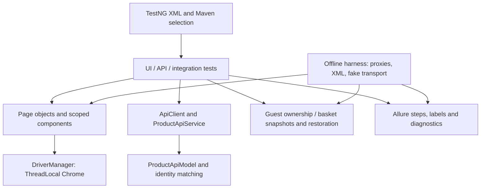

# Presentation audit / Təqdimat auditi

> Historical audit from 29 October 2026. Its counts and results describe that snapshot. For the current 30 October inventory, retired blocked tests and actual cleanup verification, see [PROJECT_CLEANUP_REPORT.md](PROJECT_CLEANUP_REPORT.md).

29 October 2026, Asia/Baku. This audit prepares the repository for an honest GitHub, LinkedIn and CV presentation. It changes documentation only; existing working-tree Phase 1–5 changes are not attributed to this audit.

## Verified inventory and results

[The method-level matrix](TEST_COVERAGE_MATRIX.md) reconciles **78 top-level test classes / 269 methods**: UI 40/42, core API 12/12, opt-in API diagnostic 1/1, integration 2/2, offline 23/212. API-named offline classes remain offline; nested synthetic fixtures are listed separately. The implemented minimum course coverage is present: more than 10 UI methods, more than 6 API methods covering GET/POST/PUT/DELETE, and 2 integration methods. Implementation is not a pass claim.

| Fresh local check | Actual outcome / evidence |
| --- | --- |
| Oracle JDK 23.0.2, Maven 3.10.0, production/test compilation | Exit 0 / BUILD SUCCESS; `target/presentation-audit-20261029/compile.log`, finished 18:05:48 +04:00 |
| Expanded offline regression, sequential final attempt | Exit 0; **291 PASS, 0 failures/errors/skips**; 212 distinct method identities across 23 classes; log finished 18:10:17 +04:00; `offline-final/surefire/`, `offline-final/results/` |
| Static suite/report workflow validation | `Test-AllureWorkflow.ps1`: PASS; 10 standard + 2 diagnostic API entries, 14 group identifiers, 178 XML references, documented PowerShell syntax/selectors and safety guards |
| Documentation checks | All new local links resolve; all 269 matrix method rows accounted for; seven new PowerShell blocks parse without errors. API/diagnostic category dry runs select the documented scopes without Maven/HTTP. README whitespace check passes. Repository-wide `diff --check` still reports a pre-existing trailing blank line in `scripts/Test-AllureWorkflow.ps1`, left untouched. |
| Guest read-only defect recheck | Maven exit 1; **2 test bodies executed, 2 Surefire failures, 0 errors/skips**, finished 18:13:17 +04:00. Deep-link label assertion reproduced; keyboard timed out opening homepage before keyboard assertions. Allure correctly classifies **1 failed / 1 broken**, not two confirmed product defects. |
| Isolated Allure generation | Exit 0 for `offline-final/report/` and `defects-final/report/`; summary widgets checked against raw results. HTML rendering success is not a test pass; browser visual inspection of these new reports was not performed. |

All fresh paths above are beneath `target/presentation-audit-20261029/`. The first offline attempt failed before execution with a class-loading error while Maven builds overlapped. The sequential retry passed; no source/test change was required. The first guest attempt could not execute sandboxed ChromeDriver and produced setup failures/skips; the permitted desktop recheck then ran both bodies. Both unsuccessful attempts remain in `offline/`, `defects/` and their logs. No login, authenticated API call, cart change or submission was performed.

Original UI **22 PASS**, Phase 1 **8 PASS**, Phase 2 **4 PASS**, Phase 3 **3 PASS / 1 FAIL**, Phase 4 **two coded / live BLOCKED**, Phase 5 **1 PASS / 1 FAIL**, and expanded offline **291 PASS** remain **separate executions**. Earlier failed/debug runs remain intact. A later 10-PASS standard API run (`20261025-144844-474840f9`, Maven exit 0, standard exclusions retained) and 2-PASS integration run (`20261024-142944-796ebb91`, Maven exit 0) were found in local manifests/raw results. They do not resolve POST-zero, unauthorized or invalid-slug contract limitations. Protected valid-login history was found separately; it is not part of the 22-invocation standard UI selection and was not rerun.

## Architecture and reliability review

- **POM/components:** pages expose actions and observations; tests retain assertions. Reusable grid, gallery, reviews, related-products, installment, catalog and price components scope duplicate/responsive DOM. `ProductPriceComponent` distinguishes current card/detail prices from old prices; exact `BigDecimal` comparisons avoid floating-point drift.
- **API/model:** REST Assured transport is injectable for offline checks; public requests omit authorization. Authenticated clients acquire credentials lazily, cache the token within the JVM and report status/schema/type/response-time assertions through support code. GET, POST, PUT and DELETE are exercised by live scenarios; existence of a PATCH client method is not a PATCH test claim.
- **Integration:** public product identity/discounted UI-price comparison is separate from authenticated basket API-to-UI visibility. The latter requires account approval and restoration and is excluded from this audit's execution.
- **State:** single-product guest support and account snapshots/restore logic are separate from prospective Phase 4 multi-row support. JVM/file locks coordinate cooperating local runners, not distributed CI jobs or unrelated clients. Cleanup failures preserve original failures. Phase 4 live setup and runner remain fail-closed; calculated row totals do not satisfy independent displayed-total acceptance.
- **Data-driven checks:** JSON supplies three nonexistent search queries. Offline DataProviders expand 212 methods to 291 outer invocations; synthetic nested failures are checked by passing harness methods. Two product comparisons or two viewport widths within a method remain one invocation.
- **Waits/retries:** Selenium explicit waits handle page state and DOM replacement. A bounded sleep exists for file-lock polling, not UI readiness. Eligible `BaseTest` scenarios may retry one recognized transient Selenium failure; assertion failures and protected/mutation scenarios do not retry. Explicit `NoRetryAnalyzer` and group/class exclusions matter. Surefire reruns are separate; both were disabled for the defect recheck.
- **Parallel pilot:** `testng-parallel-ui-pilot.xml` selects homepage, category navigation and existing-product search, `parallel="classes"`, two threads. ThreadLocal lifecycle supports this narrow pilot. It excludes account/cart mutation; no fresh pilot run or general thread-safety certification is claimed.
- **Reporting:** listeners add TestNG group labels; ordinary UI failures capture diagnostics/screenshots. Sensitive reporting suppresses/redacts protected data. Category scripts validate ownership/timestamps and preserve real failures; Phase runners isolate results and do not rewrite historical aggregates.

## CI and report evidence limits

The checked-in [workflow](../.github/workflows/maven-ci.yml) triggers for main push/PR or manual dispatch, uses Ubuntu/Temurin 23, compiles with `-DskipTests test-compile`, runs **`-Poffline test`** and uploads Surefire reports with `if: always()`. It performs no live UI/API/integration tests, Allure HTML generation or deployment. AGENTS.md's sentence saying CI runs only `WaitConditionResultTest` is stale; workflow source is authoritative for configured scope. No remote Actions run was inspected, so no hosted green badge or successful remote execution is claimed.

Read all five phase evidence documents, root TestNG suites, test/main source, reporting scripts, POM, README, .gitignore and retained Allure run/source manifests and summary widgets (76 metadata/summary files). Raw results were reconciled by `fullName`, status and start time; copied historical aggregates were not treated as new executions. New reports contain only this audit's raw results. Original report directories, pointers and known failures were not edited. Ignored generated paths are inspected only for the evidence requested by this task.

## Repository hygiene and privacy

- Current tracked-file and source/docs working-tree scan found **no high-confidence private key, GitHub token, JWT or hardcoded credential literal**. No sensitive values were printed. This is a scoped pattern/manual review, not a certification of all Git object history or all possible secret formats.
- `git ls-files` found no tracked `target/`, `.allure/`, `.firecrawl/`, root Allure result/report artifacts. Existing .gitignore already covers credentials/environment overrides, private keys, build/classes, IDE files, reports, logs and transient editor files; no speculative ignore change was needed.
- Credentials come from environment variables; no values were requested or echoed. Offline fake tokens/accounts use synthetic fixtures and must not be mistaken for live secrets. Public product amounts/slugs are not private account data.
- README host-specific user paths were replaced with portable checkout-relative examples. Historical phase/submission documents intentionally retain original evidence paths; source reports/manifests also contain local Windows paths and host/thread metadata. These are privacy/portability findings, not leaked credentials.
- Screenshot/URL/exception attachments can expose browser or account data despite sensitive-flow guards. Existing reports are **not anonymized**. Before external publication, inspect a separate sanitized copy (attachments, parameters, host/thread labels, absolute paths and URLs). Preserve original evidence and real failures. No report was uploaded or published.
- A separate scan read **3,750 retained/fresh raw Allure JSON and text/HTML attachment files** and found no high-confidence private-key/GitHub-token/JWT pattern. Host labels occur in 2,220 files and absolute user paths in 13; email-shaped metadata matches were traced to thread labels rather than asserted as private account email leaks. Screenshots were not exhaustively secret-scanned; these findings do not clear reports for public release.
- Git initially refused ownership validation. Read-only commands used a per-command `safe.directory` setting; no global Git configuration changed. No staging, commit or push occurred. Existing uncommitted source/suite/script changes were preserved.

## Exact audit file change manifest

| File | Change |
| --- | --- |
| `README.md` | Added bilingual presentation/evidence navigation and current audit summary; clarified dated historical wording; portable local-path examples. Existing detailed commands and phase evidence retained. |
| `docs/TEST_COVERAGE_MATRIX.md` | New 269-method inventory, suite/group selection, purposes, invocation counts, statuses and last located raw evidence; synthetic fixtures separated. |
| `docs/KNOWN_ISSUES.md` | New product findings, framework limitations, blocked acceptance and release conditions. |
| `docs/defects/BE-UI-001-keyboard-navigation.md` | New reproducible keyboard finding, standards basis and current recheck limitation. |
| `docs/defects/BE-UI-002-filter-deep-link.md` | New deep-link report with exact URL, restored ordering, control mismatch and unconfirmed root cause. |
| `docs/PRESENTATION_GUIDE.md` | New portable PowerShell run/report guide and bilingual GitHub/LinkedIn/CV wording with evidence boundaries. |
| `docs/PRESENTATION_AUDIT.md` | This architecture, verification, hygiene, evidence and release audit. |

Local ignored audit artifacts only: `target/presentation-audit-20261029/` contains source/hash inventories, reconciliation/privacy summaries, command logs, failed initial attempts, final Surefire/raw Allure and two generated HTML reports. They are not proposed GitHub source files. No Java, POM, XML suite, workflow, .gitignore, prior phase document or runner was changed by this audit.

`target/presentation-audit-20261029/artifact-file-manifest.json` enumerates the audit artifacts with SHA-256 hashes (excluding the manifest itself). `baseline.json` / `final-validation.json` confirm that README is the only pre-existing file changed since the audit baseline; all pre-existing Java, suite, runner and phase document hashes match.

## Release-readiness decision / Buraxılışa hazırlıq

Suitable for a portfolio presentation with [explicit limitations](KNOWN_ISSUES.md). Block a complete-live-acceptance claim until Phase 4 DOM/displayed totals and same-session cleanup are verified; resolve or disclose keyboard and sort-control findings, POST-zero semantics and unauthorized recovery. Public report release also requires privacy review; remote CI success requires remote execution evidence. The keyboard homepage timeout limits today's revalidation, not the original Phase 3 failure.

Azərbaycanca: Java 23 kompilyasiyası və **291 offline PASS** təsdiqləndi. Canlı təkrar yoxlamada deep-link qüsuru yenidən müşahidə olundu, klaviatura testi isə ana səhifənin açılmasında timeout verdi; bu iki nəticə eyni növ məhsul qüsuru kimi təqdim edilmir. CI yalnız offline-dır. Mərhələ 4 canlı qəbul/təmizləmə təsdiqi yoxdur. Tarixi nəticələr bir ümumi yaşıl icra sayılmır. Mənbə testləri və əvvəlki hesabatlar qorunub; staging, commit və push edilməyib.
